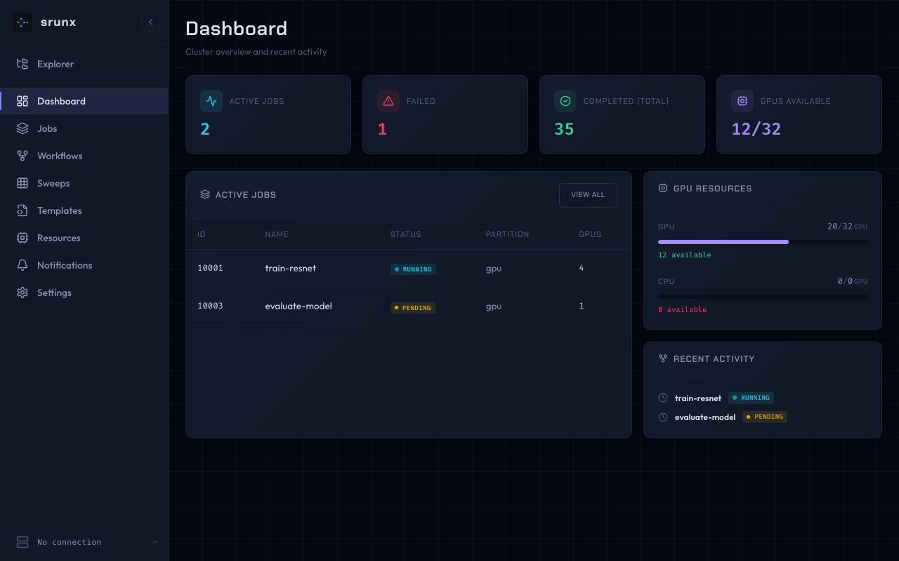
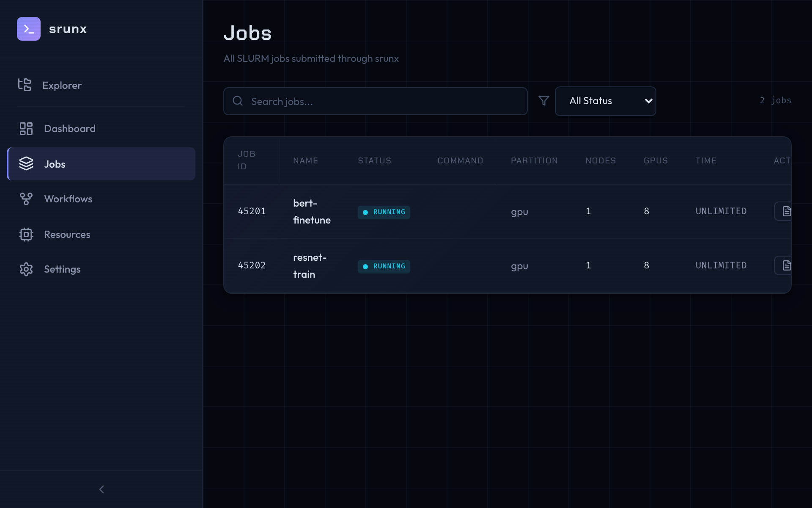
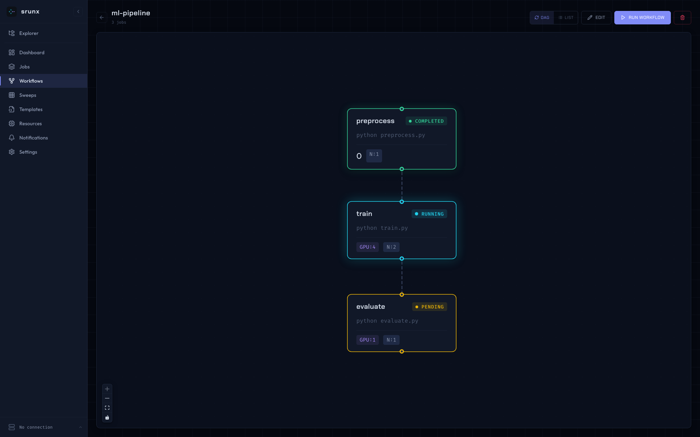
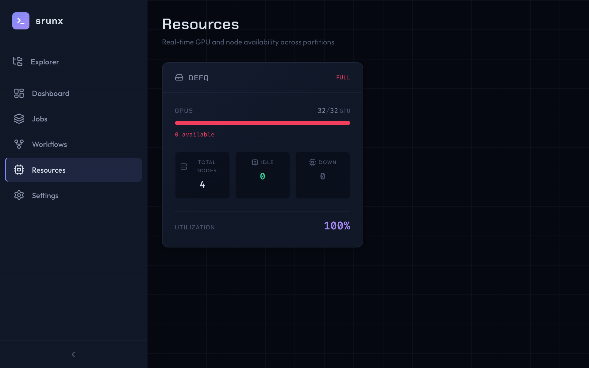
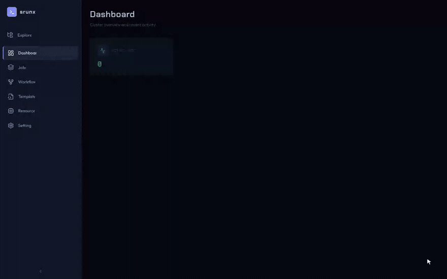
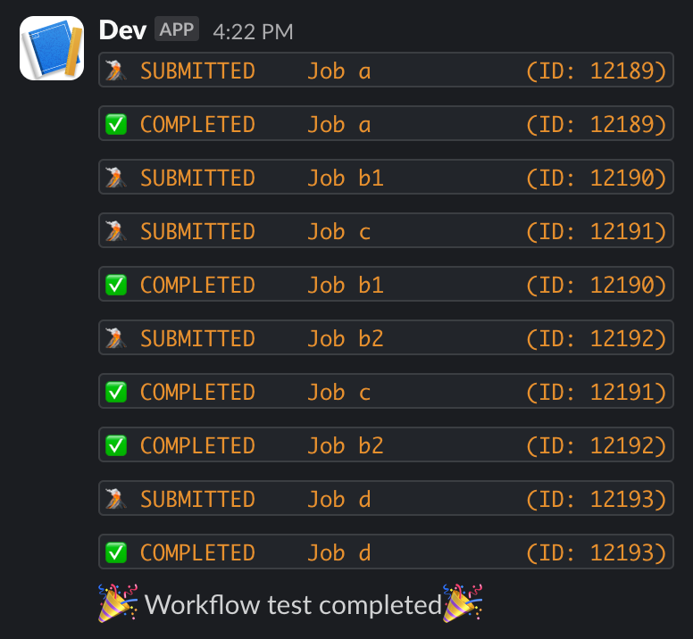

<div align="center">


# srunx

**A unified CLI, web dashboard, and Python API for SLURM job management.**

Stop juggling `sbatch` scripts, `squeue` loops, and SSH sessions.

[](https://pypi.org/project/srunx/)
[](https://pypi.org/project/srunx/)
[](https://www.python.org/downloads/)
[](LICENSE)
[](https://github.com/ksterx/srunx/actions)
[](https://ksterx.github.io/srunx/)
[](https://deepwiki.com/ksterx/srunx)

</div>

<div align="center">
  
</div>

- **Submit & manage** SLURM jobs from CLI, browser, or Python
- **Orchestrate** multi-step workflows with YAML and dependency graphs
- **Monitor** GPU availability and job states with Slack notifications
- **Local or remote, one CLI** — target a local SLURM or any SSH'd cluster with `--cluster <name>`; no shell-in, no separate "remote" commands — the same verbs you already know
- **Container-native** — Pyxis, Apptainer, and Singularity support built in

## Installation

Requires Python 3.12+ and access to a SLURM cluster (local or via SSH).

```bash
uv add srunx             # with uv (recommended)
pip install srunx        # or with pip
```

The web dashboard and Slack notifications are included in the base install — no extras required.

For AI agent integration (MCP server), add the `mcp` extra:

```bash
uv add "srunx[mcp]"
```

## Quick Start

Submit a job, wait for it, and view the logs — end to end:

```bash
# 0. One-time: register a cluster (no implicit default)
$ srunx cluster add local --local --default

# 1. Submit
$ srunx sbatch --job-name training --gpus-per-node 2 --conda ml_env --wrap "python train.py"
✅ Submitted job training (id=847291)

# 2. Follow until completion
$ srunx watch jobs 847291
⠋ 847291 training  PENDING  →  RUNNING  →  COMPLETED (4m 12s)

# 3. Inspect output
$ srunx tail 847291 -n 20
```

Or describe the whole pipeline once and let srunx drive it:

```bash
srunx flow run workflow.yaml
```

### Same commands, remote cluster

Every command above accepts `--cluster <name>` and dispatches transparently over SSH — same syntax, same output, same feel as local:

```bash
srunx sbatch --cluster dgx --job-name training --gpus-per-node 2 --conda ml_env --wrap "python train.py"
srunx squeue --cluster dgx
srunx tail   --cluster dgx 847291 --follow
srunx flow run pipeline.yaml --cluster dgx
```

Without `--cluster`, srunx uses `$SRUNX_CLUSTER`, then the project's `cluster` (from `.srunx/config.toml`), then the user config's `default_cluster` — and errors if none is set. There is no implicit "local" fallback.

srunx rsyncs your code under a per-mount lock, runs `sbatch` in place on the remote, and streams logs back. Your shell never leaves the laptop.

## Why srunx?

Instead of stitching together `sbatch`, `squeue`, SSH, and a pipeline runner, srunx offers one coherent surface that covers the day-to-day SLURM loop.

| Capability | srunx | submitit | simple-slurm | Snakemake |
|---|:---:|:---:|:---:|:---:|
| CLI for submit / status / cancel | ✅ | ❌ | ❌ | ⚠️ partial |
| Python API | ✅ | ✅ | ✅ | ✅ |
| Web dashboard | ✅ | ❌ | ❌ | ❌ |
| Workflow DAG with dependencies | ✅ | ❌ | ❌ | ✅ |
| Inter-job value passing (load-time) | ✅ | ❌ | ❌ | ⚠️ via files |
| Matrix parameter sweeps | ✅ | ⚠️ manual | ❌ | ⚠️ via wildcards |
| GPU availability monitoring | ✅ | ❌ | ❌ | ❌ |
| SSH remote submit + file sync | ✅ | ❌ | ❌ | ❌ |
| Container support (Pyxis / Apptainer / Singularity) | ✅ | ⚠️ limited | ❌ | ⚠️ via rules |
| Slack notifications | ✅ | ❌ | ❌ | ⚠️ plugin |

If you need full-featured scientific workflow tooling, Snakemake / Nextflow are still the right call. srunx targets the sweet spot of *"SLURM + a few dependencies + a nice UI"* without Airflow-scale infrastructure.

## CLI

**Every command below runs locally _or_ against a remote cluster over SSH.** Add `--cluster <name>` (or set `$SRUNX_CLUSTER`) and `sbatch` / `squeue` / `sinfo` / `sacct` / `history` / `gpus` / `tail` / `watch` / `flow run` transparently dispatch to that cluster (local `sbatch` or the SSH adapter) — no shell-in first, no separate "remote" subcommand. `srunx cluster` is just for managing clusters (list / show / add / update / remove / test / sync / secret); it does not run jobs itself. There is no `-C` short form (`-C` is sbatch's `--constraint`), and Slurm's own `--clusters` / `-M` is rejected.

`Type` column: **SLURM** = mirrors the native SLURM CLI (muscle memory maps directly); **srunx** = srunx-original command with no direct SLURM counterpart.

### Job submission & control (SLURM parity)

| Command | Type | Description |
|---------|------|-------------|
| `srunx sbatch [options] <script> [args...]` / `srunx sbatch --wrap "<cmd>"` | SLURM | Submit a SLURM job (native sbatch options such as `--array` / `--qos` pass through; as with sbatch, options go before the script and tokens after it go to the script) |
| `srunx scancel <id>` | SLURM | Cancel a job |

### Status & accounting

| Command | Type | Description |
|---------|------|-------------|
| `srunx squeue` | SLURM | List active jobs (use `-j <id>` for a single job's state) |
| `srunx sinfo` | SLURM | Partition / state / nodelist listing (native-sinfo parity) |
| `srunx sacct` | SLURM | Real SLURM `sacct` wrapper (cluster accounting DB) |
| `srunx history` | srunx | srunx's own submission history (SQLite-backed) |
| `srunx gpus` | srunx | GPU aggregate summary across partitions |
| `srunx tail <id>` | srunx | View / stream job logs |
| `srunx watch jobs\|resources\|cluster` | srunx | Watch for state changes / resource availability |

### Workflows & sweeps

| Command | Type | Description |
|---------|------|-------------|
| `srunx flow` | srunx | Run / validate YAML workflows |
| `srunx flow run --arg KEY=VALUE` | srunx | Override workflow `args` from the CLI |
| `srunx flow run --sweep KEY=V1,V2 --max-parallel N` | srunx | Ad-hoc matrix parameter sweep |

### Environment & tooling

| Command | Type | Description |
|---------|------|-------------|
| `srunx cluster list\|show\|add\|update\|remove\|test` | srunx | Manage clusters (job targets) — remote execution itself is `--cluster` on the commands above |
| `srunx cluster sync` | srunx | Rsync a project mount to (or with `--pull`, from) a cluster |
| `srunx cluster secret set\|list\|unset` | srunx | Store API keys once per remote account (hidden prompt, `0600` file) |
| `srunx snapshot create\|list\|prune` | srunx | Per-commit read-only code snapshots on a cluster (`sbatch --snapshot`) |
| `srunx config show\|paths\|init\|init-project\|set\|delete\|unset` | srunx | Manage the TOML configuration (user / project) and inspect where each value comes from |
| `srunx template` | srunx | Manage job templates |
| `srunx ui` | srunx | Launch the web dashboard |

More CLI examples: [User Guide](https://ksterx.github.io/srunx/how-to/user_guide/) · Python-side counterparts: [API Reference](https://ksterx.github.io/srunx/reference/api/)

## Web Dashboard

A dashboard for visual cluster management. Connect to your SLURM cluster over SSH and manage jobs, workflows, and resources from a browser.

```bash
srunx ui                # -> http://127.0.0.1:8000
srunx ui --port 3000    # custom port
srunx ui --project ~/work/other-repo   # serve extra projects (repeatable)
```

The cluster and project are chosen in the sidebar; every API request carries them explicitly.

### Jobs

Browse, search, filter, and cancel jobs.



### Workflow DAG

Visualize job dependencies. Run workflows directly from the UI.



### Resources

GPU and node availability per partition.



### Explorer

Browse remote files via the selected project's mounts. Shell scripts can be submitted as sbatch jobs directly from the file tree.



Full walkthrough: [Web UI tutorial](https://ksterx.github.io/srunx/tutorials/webui/) · [Web UI how-to](https://ksterx.github.io/srunx/how-to/webui/) · [Explorer how-to](https://ksterx.github.io/srunx/how-to/explorer/)

## Workflow Orchestration

Define pipelines in YAML. Jobs run as soon as their dependencies complete — independent branches execute in parallel automatically.

```yaml
name: experiment
args:
  model: "bert-base-uncased"
  output_dir: "/outputs/{{ model }}"

jobs:
  - name: preprocess
    command: ["python", "preprocess.py", "--out", "{{ output_dir }}/data"]
    exports:
      DATA_PATH: "{{ output_dir }}/data/processed.parquet"

  - name: train
    command: ["python", "train.py", "--model", "{{ model }}", "--data", "{{ deps.preprocess.DATA_PATH }}"]
    depends_on: [preprocess]
    gpus_per_node: 2
    environment:
      container:
        image: nvcr.io/nvidia/pytorch:24.01-py3
        mounts:
          - /data:/data
    exports:
      MODEL_PATH: "{{ output_dir }}/models/best.pt"

  - name: evaluate
    command: ["python", "eval.py", "--model", "{{ deps.train.MODEL_PATH }}"]
    depends_on: [train]
```

**What this shows off:**

- **`args` with Jinja2** — reusable, parameterized pipelines (`{{ model }}`, `{{ output_dir }}`)
- **Inter-job exports** — parents declare `exports:`; children read them via `{{ deps.<parent>.<key> }}`, fully resolved at workflow load time (no runtime env files)
- **Containers per job** — Pyxis / Apptainer / Singularity are first-class (`environment.container`)
- **Dependency-driven scheduling** — `evaluate` blocks on `train`; parallel branches run automatically

Run it:

```bash
srunx flow run workflow.yaml              # execute
srunx flow run workflow.yaml --dry-run    # show plan only
srunx flow run workflow.yaml --from train # resume / partial execution
```

Retry with `retry: N` and `retry_delay: <seconds>` per job.

### Parameter Sweeps

Run the same workflow across a matrix of hyperparameters without copying YAML. Each cell materializes into its own sbatch submission and is tracked independently.

```yaml
name: train
args:
  lr: 0.01
  seed: 1

sweep:
  matrix:
    lr: [0.001, 0.01, 0.1]
    seed: [1, 2, 3]
  fail_fast: false
  max_parallel: 4

jobs:
  - name: train
    command: ["python", "train.py", "--lr", "{{ lr }}", "--seed", "{{ seed }}"]
    gpus_per_node: 1
```

Run it — or declare the axes ad-hoc on the command line:

```bash
srunx flow run train.yaml                                                # YAML-declared sweep
srunx flow run --sweep lr=0.001,0.01 --max-parallel 2 train.yaml          # ad-hoc
srunx flow run --sweep lr=0.001,0.01 --max-parallel 2 --dry-run train.yaml
```

Sweeps are a first-class concept across **CLI, Web UI, and MCP**. Cells run on the selected cluster (Web-triggered sweeps on SSH clusters route through a bounded `SlurmSSHExecutorPool`). The Web UI surfaces per-cell progress with ETA, filter / sort, and per-cell cancellation.

Full workflow surface (validation, retries, partial execution, sweep recipes): [Workflows how-to](https://ksterx.github.io/srunx/how-to/workflows/)

## Monitoring

```bash
# Monitor a job until completion
srunx watch jobs 12345

# Wait for GPUs, then submit
srunx watch resources --min-gpus 4
srunx sbatch --wrap "python train.py" --gpus-per-node 4

# Periodic cluster reports to Slack
srunx watch cluster --schedule 1h --notify $SLACK_WEBHOOK
```

Full monitoring options (continuous watch, thresholds, scheduled reports): [Monitoring how-to](https://ksterx.github.io/srunx/how-to/monitoring/)

## Remote SSH

Keep your local editor workflow while the jobs actually run on the cluster. Add a cluster **once**, and every srunx command accepts `--cluster <name>` with the same syntax as local:

```bash
# One-time setup (user config: $XDG_CONFIG_HOME/srunx/config.toml)
srunx cluster add dgx --host dgx1 --default      # host alias from ~/.ssh/config
srunx cluster test dgx

# Per project: .srunx/config.toml (commit it)
cd ~/projects/ml-exp
srunx config init-project                        # name = directory name
srunx config set cluster dgx --project           # this project's default cluster
srunx config set remote_dir /home/user/ml-exp --cluster dgx --project

# Same verbs you already use — now against the remote cluster
srunx sbatch train.sh                            # auto-rsyncs the project + sbatch runs in-place on the remote path
srunx squeue                                     # live queue on the remote cluster
srunx tail 847291 --follow                       # stream remote logs
srunx flow run pipeline.yaml                     # full DAG: sync once, hold the per-mount lock, submit
```

- SSH config hosts, ProxyJump support; connection settings live only in the user/system config, never in a project file
- Environment variable passthrough (`--env KEY=VALUE`)
- File sync via rsync with per-mount locking; the first sync to a new remote path asks for confirmation (`--yes` to approve)
- Layered job defaults (user → cluster → project → project × cluster → script `#SBATCH` → CLI flags); `srunx config show` shows where each value came from
- `sbatch --snapshot` runs the job from a read-only per-commit copy of your git repo, so later syncs cannot change code under queued jobs

Mount model, sync semantics, snapshots, and in-place execution rules: [SSH sync how-to](https://ksterx.github.io/srunx/how-to/sync/)

## Slack Notifications

Get notified when jobs finish — set `SLACK_WEBHOOK_URL` (or configure it in the web dashboard), then append `--slack` to any `srunx flow run` command. In Python, pass `SlackCallback` to the runner (see the Python API section below).

<div align="center">
  
</div>

```bash
export SLACK_WEBHOOK_URL="https://hooks.slack.com/services/..."
srunx flow run workflow.yaml --slack
```

## MCP Server

srunx ships an MCP server so Claude Code (and other MCP clients) can submit jobs, inspect the queue, and drive workflows over stdio. Install the extra and register the server with your client:

```bash
uv add "srunx[mcp]"
srunx-mcp                                                              # launch the stdio server directly

# Or register with Claude Code in one shot
claude mcp add --scope user srunx -- uvx --from 'srunx[mcp]' srunx-mcp
```

Once connected, the agent can call `run_workflow` with optional sweep and mount parameters:

```python
run_workflow(
    yaml_path="train.yaml",
    sweep={"matrix": {"lr": [0.001, 0.01]}, "max_parallel": 2},
    cluster="dgx",
    project="/home/me/ml-exp",
    mount="ml-exp",
)
```

`cluster` is always explicit — MCP tools never fall back to an implicit cluster (call `list_clusters` to see what is configured). `project` is the project root holding `.srunx/config.toml`; it supplies project defaults and the mounts that `mount=<name>` refers to. `mount` translates `work_dir` / `log_dir` into that mount's remote paths and requires an SSH `cluster` plus `project`, so the agent can launch mount-aware submissions against a remote cluster without leaving the chat.

Setup + tool-by-tool usage: [MCP Setup tutorial](https://ksterx.github.io/srunx/tutorials/mcp-setup/) · [MCP Usage how-to](https://ksterx.github.io/srunx/how-to/mcp-usage/) · [MCP Tools reference](https://ksterx.github.io/srunx/reference/mcp-tools/)

## Python API

The full CLI surface is available as a Python library. Use it inside notebooks, existing Python pipelines, or custom tooling.

**Submit and wait:**

```python
from srunx import Job, JobResource, JobEnvironment, Slurm

job = Job(
    name="training",
    command=["python", "train.py"],
    resources=JobResource(nodes=1, gpus_per_node=2, time_limit="4:00:00"),
    environment=JobEnvironment(conda="ml_env"),
)

client = Slurm()
completed = client.run(job)  # submit, poll, and return when terminal
print(completed.status, completed.job_id)
```

**Fire-and-track:**

```python
submitted = client.submit(job)                 # returns Job with job_id populated
info = client.retrieve(submitted.job_id)       # poll status on demand
client.cancel(submitted.job_id)                # if you change your mind
```

**Run a YAML workflow programmatically, with callbacks:**

```python
from srunx.observability.notifications.legacy_slack import SlackCallback
from srunx.runtime.workflow.runner import WorkflowRunner

runner = WorkflowRunner.from_yaml(
    "workflow.yaml",
    callbacks=[SlackCallback(webhook_url="...")],
)
runner.run()                                    # blocks until the DAG finishes
```

## Documentation

Full docs (Diátaxis-structured) at **[ksterx.github.io/srunx](https://ksterx.github.io/srunx/)**:

- **Tutorials** (learn by doing) — [Installation](https://ksterx.github.io/srunx/tutorials/installation/) · [Quickstart](https://ksterx.github.io/srunx/tutorials/quickstart/) · [Web UI](https://ksterx.github.io/srunx/tutorials/webui/) · [MCP setup](https://ksterx.github.io/srunx/tutorials/mcp-setup/)
- **How-to guides** (solve specific tasks) — [User guide](https://ksterx.github.io/srunx/how-to/user_guide/) · [Workflows & sweeps](https://ksterx.github.io/srunx/how-to/workflows/) · [Monitoring](https://ksterx.github.io/srunx/how-to/monitoring/) · [SSH sync](https://ksterx.github.io/srunx/how-to/sync/) · [Web UI](https://ksterx.github.io/srunx/how-to/webui/) · [Explorer](https://ksterx.github.io/srunx/how-to/explorer/) · [MCP usage](https://ksterx.github.io/srunx/how-to/mcp-usage/) · [Settings](https://ksterx.github.io/srunx/how-to/settings/) · [Smoke-test notifications](https://ksterx.github.io/srunx/how-to/smoke-test-notifications/)
- **Reference** (look up exact API) — [Python API](https://ksterx.github.io/srunx/reference/api/) · [Web API](https://ksterx.github.io/srunx/reference/webui-api/) · [MCP tools](https://ksterx.github.io/srunx/reference/mcp-tools/)
- **Explanation** (how it works under the hood) — [Architecture](https://ksterx.github.io/srunx/explanation/architecture/) · [MCP architecture](https://ksterx.github.io/srunx/explanation/mcp-architecture/)

## Development

```bash
git clone https://github.com/ksterx/srunx.git
cd srunx
uv sync --dev

# Full pre-commit quality gate
uv run pytest && uv run mypy . && uv run ruff check .
```

Contributions welcome — please open an issue or PR on [GitHub](https://github.com/ksterx/srunx).

## License

Apache-2.0
