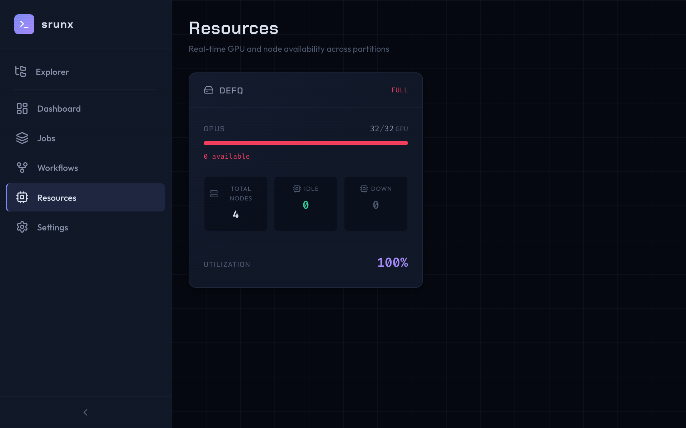

# Web UI How-to Guide

Practical recipes for common Web UI tasks.

## Connect to a Different Cluster

The Web UI works with the clusters in your user config. Pick the cluster in the
**sidebar**; the choice is kept in the browser and sent with every API request
(`?cluster=<name>`), so there is no server-side "current cluster" and two tabs
can target different clusters.

Add a cluster from **Settings > Clusters** or from the CLI:

``` bash
srunx cluster add other-cluster --host other-login      # alias from ~/.ssh/config
srunx cluster add direct --hostname slurm.example.com --username user \
    --key-file ~/.ssh/id_ed25519
```

The sidebar initially selects the project's `cluster`, else `default_cluster`.
The Web UI talks to SLURM over SSH, so SLURM pages need an SSH cluster; a
cluster with `transport = "local"` is rejected for those requests.

## Serve Several Projects

The project containing the directory you start `srunx ui` from is always
served. Add more with `--project` (repeatable) or `SRUNX_WEB_PROJECTS`
(paths separated by `:`):

``` bash
srunx ui --project ~/work/repo-a --project ~/work/repo-b
SRUNX_WEB_PROJECTS=~/work/repo-a:~/work/repo-b srunx ui
```

Each project is a directory containing `.srunx/config.toml`. Select the project
in the sidebar; it is sent as `?project=<name>` and decides the mounts and
project defaults the UI uses. Workflows are stored per mount in
`<mount local path>/.srunx/workflows/` (for the project-root mount, that is the
project's own `.srunx/workflows/`).

## Change the Server Port

By default, the server runs on port 8000. Use the `--port` option:

``` bash
srunx ui --port 3001
```

## Monitor GPU Resources



1.  Navigate to **Resources** in the sidebar
2.  Each partition shows:
    - GPU utilization bar with color coding (green \< 70%, orange \< 90%, red \> 90%)
    - Total/idle/down node counts
    - Overall utilization percentage
3.  Data refreshes every 10 seconds via polling

## Cancel a Running Job

1.  Navigate to **Jobs**
2.  Find the job in the table (use search or status filter)
3.  Click the red **cancel button** (X icon) in the Actions column
4.  The job will be cancelled via `scancel` on the remote cluster

## View Job Logs

1.  Navigate to **Jobs**
2.  Click the **log icon** next to a job
3.  Switch between **stdout** and **stderr** tabs
4.  For running jobs, logs are polled every 3 seconds

## Upload and Visualize a Workflow

1.  Navigate to **Workflows**
2.  Click **Upload YAML**
3.  Select a `.yaml` or `.yml` file
4.  After upload, click **View DAG** on the workflow card
5.  The DAG view shows:
    - Job nodes with status badges
    - Dependency edges between jobs
    - Resource indicators (GPU count, node count)
    - Click a node to see detailed job information
6.  Toggle between **DAG** and **List** views using the toolbar buttons

!!! warning
    Workflow YAML files containing `python:` args are rejected for security reasons.
    Use `python:` args only via the CLI (`srunx flow run`).

## Build a Workflow with the DAG Builder

1.  Navigate to **Workflows** and click **New Workflow**
2.  Enter a workflow name in the toolbar input (alphanumeric, hyphens, and underscores only)
3.  Click **Add Job** to add job nodes to the canvas
4.  Click each node to open the property panel and configure name, command, and resources
5.  Drag from a node's bottom handle to another node's top handle to create a dependency
6.  Click **Save Workflow** to validate and persist the workflow as YAML

The builder performs client-side validation before submitting:

- Every job must have a non-empty name and command
- Job names must be unique
- The dependency graph must be acyclic (no circular dependencies)

## Edit Job Properties

1.  Click a job node on the DAG builder canvas
2.  The property panel slides in from the right with these sections:
    - **Basic** — Name, command, work directory, log directory
    - **Resources** — Nodes, GPUs per node, tasks per node, CPUs per task, memory, time limit, partition, node list
    - **Environment** — Conda environment, virtualenv path, environment variables
    - **Container** — Enable/disable container mode with runtime (Pyxis, Apptainer, Singularity), image, mounts, workdir
    - **Retry** — Retry count and delay in seconds
3.  Changes are applied immediately to the node on the canvas
4.  Click the **X** button or click empty canvas space to close the panel
5.  Click the **trash icon** to delete the selected job

## Use the File Browser for Remote Paths

The file browser lets you pick files and directories from your local project tree, automatically translating them to remote paths.

1.  Select a project and an SSH cluster in the sidebar; the project needs at least one mount on that cluster (see [Manage Mount Points](#manage-mount-points))
2.  In the property panel, click the **folder icon** next to Command, Work Dir, or Log Dir
3.  Select a mount from the **Project** dropdown
4.  Browse the directory tree by clicking folders to expand them
5.  Click a file or directory to select it (the footer shows the remote path)
6.  Click **Select** to insert the remote path into the field

!!! note
    When selecting a file for the Command field, the path is made relative to the work directory if one is set. This keeps your commands portable.

## Manage Mount Points

Mount points map the selected project's local directories to remote paths on
the selected cluster. They are declared in the project config
(`.srunx/config.toml`): the project root maps to `[clusters.<name>] remote_dir`
(or the remote default workspace), and extra mounts come from
`[[clusters.<name>.mounts]]`. See [Project Synchronization](sync.md#mount-points).

``` bash
srunx config set remote_dir /home/researcher/ml-project --cluster myserver --project
srunx cluster show myserver      # lists the project's mounts on myserver
```

The **Project** tab in Settings edits `remote_dir`, sync, and excludes per
cluster and shows the resolved mounts.

## Sync Files Before Running

The file browser shows local files, but workflows execute on the remote cluster. Ensure files are synchronized before running.

**From the file browser:**

1.  Open the file browser from any path field in the property panel
2.  Click **Sync Now** in the yellow banner at the top of the file tree
3.  Wait for the sync to complete (the button changes to "Synced")

**From the command line:**

``` bash
srunx cluster sync myserver --mount ml-project
```

!!! warning
    If you modify local files after syncing, you must sync again before running the workflow on the cluster.

## Change Dependency Types

By default, edges use `afterok` (run only if the upstream job completes successfully). To change the dependency type:

1.  Click an edge on the DAG builder canvas
2.  A popover appears with four options:
    - `afterok` — Run after successful completion (default)
    - `after` — Run after the upstream job starts running
    - `afterany` — Run after the upstream job ends regardless of status
    - `afternotok` — Run only if the upstream job fails
3.  Click the desired type. The edge updates immediately

## Run a Workflow

1.  Navigate to **Workflows** and click a workflow card to open the detail page
2.  Click **Run Workflow** in the toolbar
3.  The system identifies referenced mounts by matching each job's `work_dir` against mount remote paths (longest prefix match), then syncs them via rsync
4.  Jobs are submitted in dependency order. SLURM handles scheduling through `--dependency` flags (e.g., `--dependency=afterok:12345`)
5.  Status updates appear in the DAG view every 10 seconds. Each node shows the current SLURM state (PENDING, RUNNING, COMPLETED, FAILED)

!!! note
    The run transitions through these phases: `syncing` (pushing files), `submitting` (sending sbatch commands), `running` (polling job statuses), then a terminal state (`completed`, `failed`, or `cancelled`).

## Run a Parameter Sweep

Launch the same workflow over a cross-product of arg values without
duplicating YAML files. Every cell runs as an independent `workflow_run`
under one parent `sweep_run`.

**Open the Run dialog:**

1.  Navigate to **Workflows**
2.  On the target workflow card, click the **Run** button (triangle icon)

**Toggle LIST mode on args:**

1.  Each arg row has a **SINGLE | LIST** toggle on the right
2.  Switch the arg you want to sweep to **LIST**
3.  Enter comma-separated values (for example `0.001, 0.01, 0.1`)
4.  Repeat for any additional sweep axes -- the cell count is the
    cross-product of all LIST args
5.  A `Sweep: N cells . lr[3] . seed[3]` badge appears above the submit
    button, showing the total cell count and the cardinality of each axis

**Configure Advanced options:**

1.  Expand the **Advanced** section below the args
2.  Toggle **fail_fast** to cancel peers on first failure (default: off)
3.  Set **max_parallel** (default: 4; required for sweeps)

**Submit:**

1.  Click **RUN SWEEP (N)** where N is the cell count
2.  The UI navigates to `/sweep_runs/{id}` for the new sweep

**Track progress on the sweep detail page:**

- **Progress bar** -- segmented by cell status
  (completed / failed / cancelled / running)
- **ETA** -- linear estimate based on completed cells; hidden until at
  least one cell reaches a terminal state
- **Draining indicator** -- spinner plus "draining pending cells" label
  while a cancelled sweep finishes up active cells
- **Cells table** with:
    - **Status filter** dropdown (all / pending / running / completed / failed / cancelled)
    - **Sortable columns**: #, Status, Started, Completed, Duration
    - Per-cell **cancel x** button (shown only for non-terminal cells)
- Click any cell row to drill into `/workflow_runs/{cell_id}` for the
  per-cell DAG view and logs

!!! note
    Sweep submissions route through the selected SSH cluster via a
    per-sweep connection pool.

## Cancel a Running Workflow

1.  While a workflow is running, click **Cancel** in the toolbar on the workflow detail page
2.  All submitted SLURM jobs are cancelled via `scancel`
3.  The run status changes to `cancelled`

!!! warning
    Jobs that have already completed before the cancel request are not affected. Only PENDING and RUNNING jobs are cancelled.

## Edit an Existing Workflow

1.  On the workflow detail page, click the **Edit** button (pencil icon) in the toolbar
2.  Alternatively, on the workflow list page, click **Edit** on a workflow card
3.  The DAG builder opens with all jobs and dependency edges pre-loaded on the canvas
4.  Modify job properties by clicking nodes, add or remove connections by dragging handles, or add new jobs with **Add Job**
5.  Click **Update Workflow** to validate and save the changes

The update overwrites the existing YAML file on disk. The same validation rules apply: unique job names, non-empty commands, and an acyclic dependency graph.

## Delete a Workflow

1.  On the workflow detail page, click the **delete** button (trash icon)
2.  Confirm in the dialog that appears
3.  The YAML file is removed from the workflow directory and you are redirected to the workflow list

!!! warning
    Deletion is permanent. There is no undo. Active runs for the deleted workflow are not affected (they continue to track job statuses in memory), but you will not be able to start new runs.

## View Job Logs from a Workflow Run

1.  During or after a workflow run, click a job node in the DAG view
2.  The sidebar shows job details including the SLURM job ID and current status
3.  Click **View Logs** to see stdout and stderr output
4.  For running jobs, log content is polled and refreshed automatically

## Run Without a Cluster (Frontend Only)

For frontend development or demos, the server can start without any cluster
configured:

``` bash
srunx ui
```

The startup banner then reports that no cluster is configured. SLURM endpoints return `503 Service Unavailable` while no
cluster is selected, but the frontend loads normally.

## Develop the Frontend

For frontend development with hot-reload:

``` bash
# Terminal 1: Start the backend
srunx ui

# Terminal 2: Start the Vite dev server
cd src/srunx/web/frontend
npm install
npm run dev
```

The Vite dev server runs on `http://localhost:3000` and proxies API requests to the backend on port 8000.

## Run Tests

**Backend tests:**

``` bash
uv run pytest tests/web/ -v
```

**Frontend E2E tests:**

``` bash
cd src/srunx/web/frontend
npm run test:e2e
```

**Frontend type check:**

``` bash
cd src/srunx/web/frontend
npx tsc --noEmit
```
