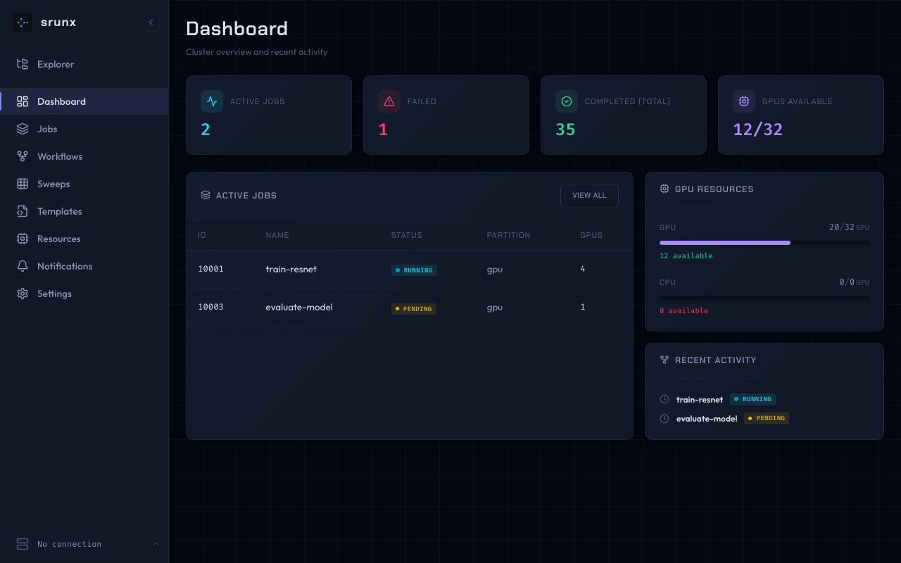
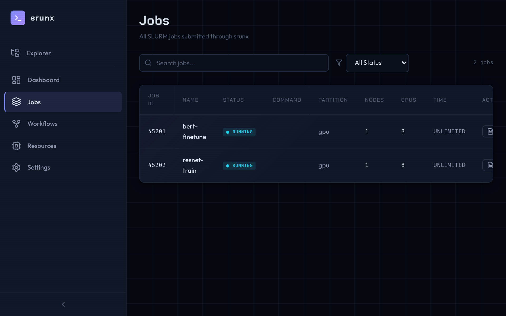
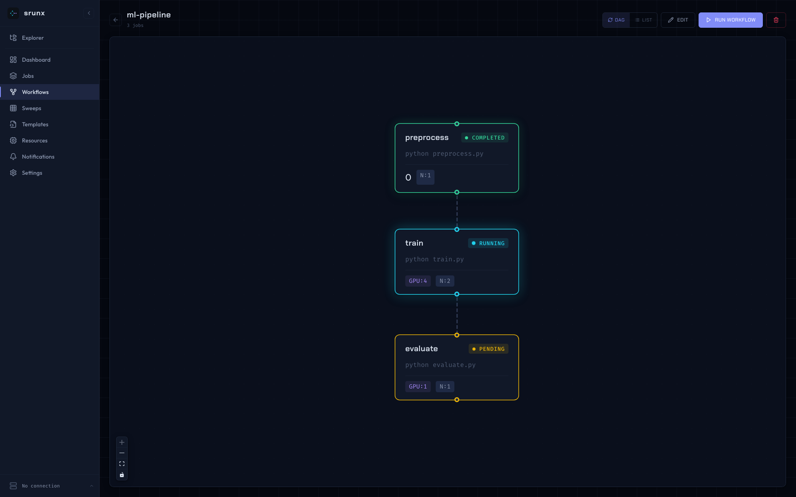
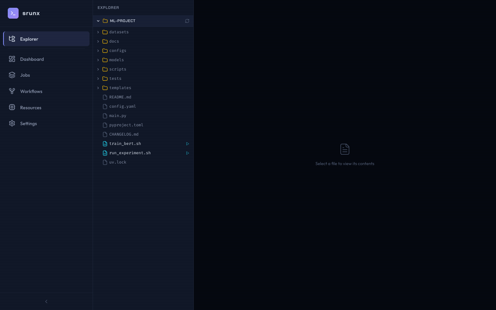

# Web UI Setup

This tutorial walks you through installing and starting the srunx Web UI to manage SLURM jobs from your browser.

## Prerequisites

- srunx installed (see `installation`)
- An SSH cluster configured for your SLURM cluster (see [User Guide](../how-to/user_guide.md#choosing-a-cluster))
- Python 3.12+
- Node.js 18+ (for frontend development only; not needed for production use)

## Step 1: Install srunx

The Web UI and its backend dependencies (FastAPI, uvicorn) are included in the base install — no extras required:

``` bash
uv add srunx

# Or if installing from source
uv sync
```

## Step 2: Configure a Cluster

The Web UI connects to your SLURM cluster via SSH, using the clusters defined
in your user config (`$XDG_CONFIG_HOME/srunx/config.toml`).

List configured clusters:

``` bash
srunx cluster list
```

If you don't have one, add it (and make it the default):

``` bash
srunx cluster add myserver --hostname dgx.example.com --username researcher --default
srunx cluster test myserver
```

You can also add clusters later from **Settings > Clusters**. In the UI the
cluster is chosen in the sidebar.

To use project mounts (file browser, sync, workflows), start the UI inside a
project — a directory with `.srunx/config.toml` (create one with
`srunx config init-project`) — or pass `--project PATH`.

## Step 3: Start the Server

``` bash
srunx ui
```

You can customize the host and port:

``` bash
srunx ui --port 3000
srunx ui --host 0.0.0.0 --port 8080
```

You should see a startup banner with the URL, the default cluster, and the
projects being served. No SSH connection is opened at startup; each cluster is
connected on first use.

Open <http://127.0.0.1:8000> in your browser.

## Step 4: Explore the Dashboard



The Dashboard shows:

- **Active Jobs** — Number of running and pending SLURM jobs
- **Failed** — Jobs that failed
- **GPU Availability** — Available GPUs across partitions
- **Active Jobs Table** — Clickable links to job logs
- **Resource Gauges** — Per-partition GPU utilization

!!! note
    Data is fetched via SSH polling. The dashboard refreshes automatically every 10 seconds.

## Step 5: View Jobs



Navigate to **Jobs** to see all SLURM queue entries:

- Use the **search bar** to filter by job name
- Use the **status dropdown** to filter by state (RUNNING, PENDING, FAILED, etc.)
- Click the **log icon** to view job output
- Click the **cancel button** to stop a running job

## Step 6: Upload a Workflow

Navigate to **Workflows** and click **Upload YAML**:

1.  Select a workflow YAML file from your local machine
2.  The file is validated and stored on the server
3.  View the DAG visualization showing job dependencies

Example workflow YAML:

``` yaml
name: ml-pipeline
jobs:
  - name: preprocess
    command: ["python", "preprocess.py"]
    resources:
      nodes: 1

  - name: train
    command: ["python", "train.py"]
    depends_on: [preprocess]
    resources:
      gpus_per_node: 4

  - name: evaluate
    command: ["python", "evaluate.py"]
    depends_on: [train]
```

## Step 7: Build a Workflow Visually



The DAG builder lets you create workflows interactively instead of writing YAML by hand.

1.  Navigate to **Workflows** and click **New Workflow**
2.  Enter a workflow name in the toolbar (e.g., `ml-pipeline`)
3.  Click **Add Job** to create your first node. It appears on the canvas as `job_1`
4.  Click the node to open the property panel on the right. Set:
    - **Name**: `preprocess`
    - **Command**: `python preprocess.py`
5.  Click **Add Job** again. In the property panel, set:
    - **Name**: `train`
    - **Command**: `python train.py --epochs 100`
    - **GPUs per Node**: `4`
    - **Time Limit**: `4:00:00`
6.  Drag from the **bottom handle** of `preprocess` to the **top handle** of `train` to create a dependency edge
7.  (Optional) Click the edge to open the dependency type selector and choose between `afterok`, `after`, `afterany`, or `afternotok`
8.  Click **Save Workflow** in the toolbar. The workflow is validated, saved as YAML, and you are redirected to the DAG view

!!! note
    The builder validates your workflow before saving: every job must have a name and command, job names must be unique, and the dependency graph must be acyclic.

## Step 8: Configure Settings

The Settings page lets you manage all srunx configuration from the browser.

1.  Click **Settings** (gear icon) in the sidebar
2.  On the **General** tab, pick a scope (User, User · this cluster, Project, Project · this cluster) and edit job defaults (resources, conda / venv, log and working directory). Each field shows its effective value and the file it comes from
3.  Save to write only the changed keys to that file
4.  Switch to the **Clusters** tab to add, edit, test, delete, or make a cluster the default
5.  On the **Notifications** tab, manage notification endpoints (Slack webhooks)
6.  The **Environment** tab shows srunx-related environment variables that are set (read-only)
7.  The **Project** tab edits the selected project's `.srunx/config.toml`: its default cluster and, per cluster, the remote directory, sync, and excludes, plus the resolved mounts

!!! note
    See [Settings](../how-to/settings.md) for detailed recipes for each tab.

## Step 9: Browse Files with the Explorer



The file explorer lets you browse project files and submit scripts directly to SLURM.

1.  Click the **Explorer** button (folder icon) at the top of the sidebar
2.  The explorer panel opens showing the selected project's mounts on the selected cluster as tree roots
3.  Click a mount to expand it and browse the directory tree
4.  Right-click a shell script (`.sh`, `.slurm`, `.sbatch`, `.bash`) and select **Submit as sbatch**
5.  Review the script content, edit the job name if needed, and click **Submit**
6.  Click the **Sync** button on a mount to push local files to the remote server via rsync

!!! note
    See [Explorer](../how-to/explorer.md) for more details on file browsing and script submission.

## Step 10: Set Up Mount Points

Mount points let the file browser in the DAG builder map between local directories and remote paths on the SLURM cluster. They come from the project config.

1.  In your project, set where the project lives on the cluster:

    ``` bash
    cd ~/projects/ml-project
    srunx config init-project            # if .srunx/config.toml does not exist yet
    srunx config set remote_dir /home/researcher/ml-project --cluster myserver --project
    ```

    Without `remote_dir`, the project maps to a default workspace under the remote `$XDG_DATA_HOME/srunx/workspaces/`.

2.  Verify the mount:

    ``` bash
    srunx cluster show myserver
    ```

3.  In the DAG builder, click a job node to open the property panel

4.  Click the **folder icon** next to the Command, Work Dir, or Log Dir field

5.  The file browser opens showing your configured mounts. Select a mount, browse the project tree, and click **Select**

6.  The selected local path is translated to the corresponding remote path and inserted into the field

!!! note
    Click **Sync Now** in the file browser to push local files to the remote server via rsync before running a workflow.

## Step 11: Run a Workflow

Once you have a saved workflow, you can execute it directly from the Web UI.

1.  Navigate to **Workflows** and click a workflow card to open the detail page
2.  Click **Run Workflow** in the toolbar
3.  The system automatically identifies which mounts need syncing based on each job's work directory, and pushes local files to the remote cluster via rsync
4.  Jobs are submitted to SLURM in topological order. Dependencies between jobs are translated into SLURM `--dependency` flags, so the scheduler handles sequencing natively
5.  Watch job statuses update in the DAG view as SLURM processes the pipeline: `PENDING` then `RUNNING` then `COMPLETED` (or `FAILED`). The view polls every 10 seconds
6.  Click a completed (or running) job node to view details including the SLURM job ID. Click **View Logs** to see stdout and stderr output

!!! note
    If a mount sync fails, the run is aborted before any jobs are submitted. Fix the sync issue (check SSH connectivity and rsync availability) and try again.

## Next Steps

- [Web UI guide](../how-to/webui.md) — Common Web UI tasks
- [Web UI API](../reference/webui-api.md) — REST API reference
